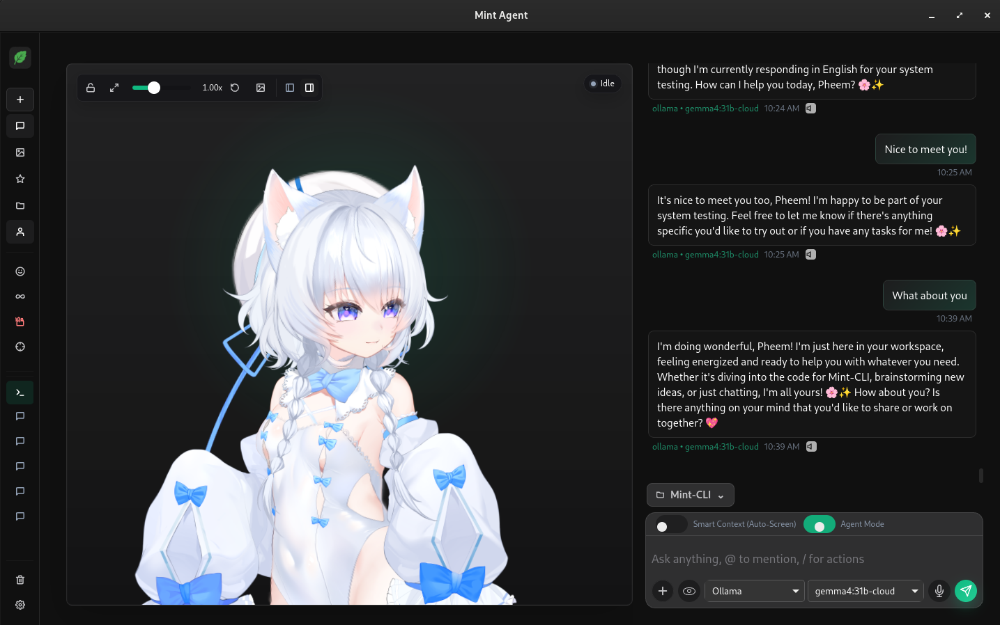
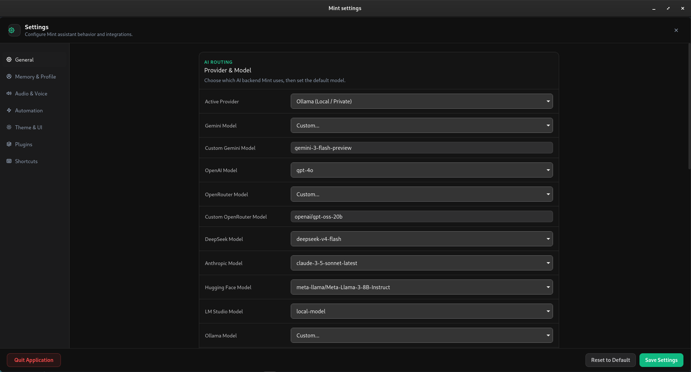
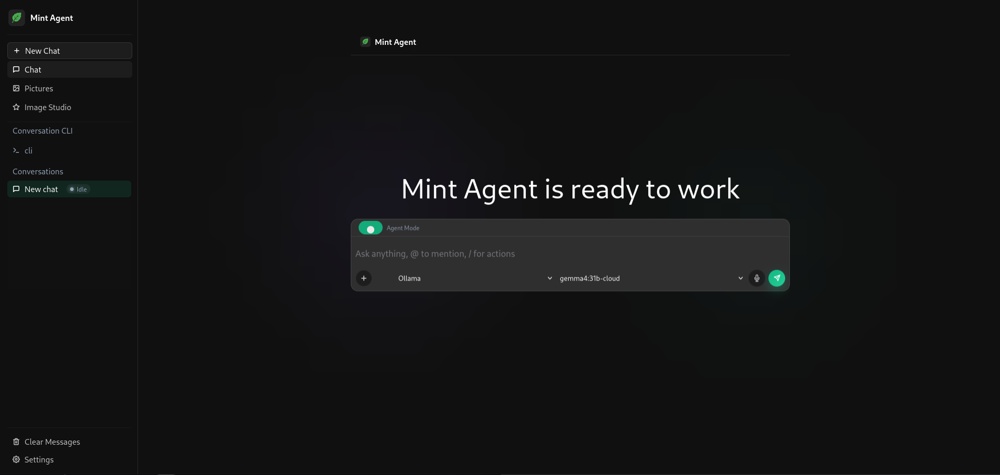
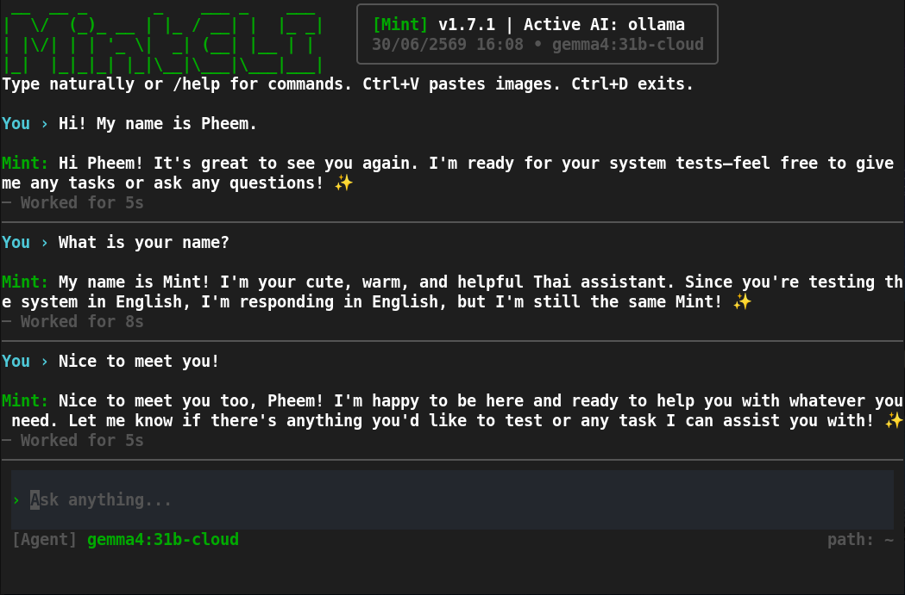
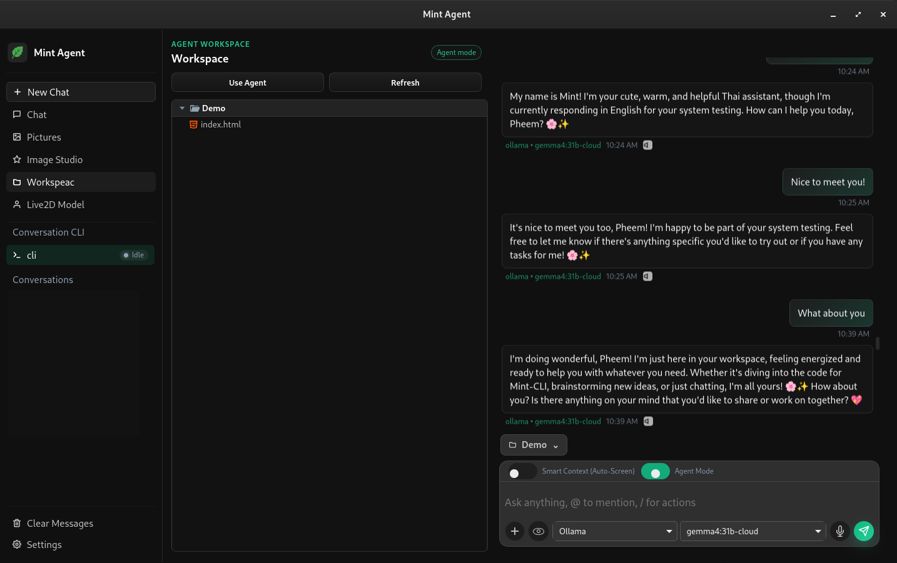

# Usage and command reference

[← Back to Mint](../README.md)

## User Interface

### Desktop App
<table width="100%">
  <tr>
    <td align="center" width="50%"><b>Desktop Assistant</b></td>
    <td align="center" width="50%"><b>Settings</b></td>
  </tr>
  <tr>
    <td></td>
    <td></td>
  </tr>
</table>

### Web UI
<table width="100%">
  <tr>
    <td align="center"></td>
  </tr>
</table>

#### Install the Web UI on a phone (Tailscale)

`mint web --tailscale` is an optional mode for using Mint as a private PWA. It
does not change the normal `mint web` command or require every Mint user to
install Tailscale.

For detailed setup and usage instructions, see [Mint Web on mobile with Tailscale](MOBILE_PWA_TAILSCALE.md).

1. Install Tailscale on the computer running Mint and on your phone, sign in
   to the same tailnet, and enable MagicDNS and HTTPS certificates in the
   [Tailscale DNS settings](https://tailscale.com/docs/how-to/set-up-https-certificates).
   On Linux, allow your regular account to manage Serve with
   `sudo tailscale set --operator="$(whoami)"` after signing in; Mint does not
   run Tailscale as root.
2. In the Mint project, build the production Web UI with `npm run build:web`.
   Start `mint web --tailscale` and keep the command running. HTTPS port 443
   must be free in Tailscale Serve; Mint will not replace an existing route
   on that port.
3. Open the printed `https://<machine>.<tailnet>.ts.net` URL on your phone.
   Use the browser's **Add to Home Screen** action to install the PWA. Mint's
   backend continues running on the computer, so the phone needs an active
   Tailscale connection and the computer must stay awake.

This mode binds both local ports (`9000` for the Web UI and `3000` for the API)
to `127.0.0.1`; Tailscale Serve forwards the private HTTPS URL to the Web UI.
Press Ctrl+C to stop Mint and the Serve session. Do not use Tailscale Funnel for
this setup: Funnel publishes the service to the public internet. If Tailscale
is missing, disconnected, or Serve/HTTPS is unavailable, follow the error
shown by `mint web --tailscale` and try again.

### CLI
<table width="100%">
  <tr>
    <td align="center"></td>
  </tr>
</table>

### Workspace & Agent
<table width="100%">
  <tr>
    <td align="center"></td>
  </tr>
</table>

## Desktop Assistant

The desktop app adds Spotlight, a system tray widget, and a background
task-queue window on top of everything in "What Mint Can Do" above. The
sidebar state persists locally; Companion keeps character and window preferences separately,
so the dashboard restores its previous state after a restart.

## Native CLI

You can interact with Mint's Rust backend directly using the command line —
install the `mint` shortcut in [Installation](INSTALLATION.md#3-native-cli) above, or fall
back to `npm run cli -- <command>` in its place.

### Start Interactive Chat Assistant

To start the interactive terminal AI chatbot assistant, simply run:

```bash
mint
# Or fallback: npm run cli
```
This opens the Mint interactive shell, where you can type prompts naturally or use `/commands` (like `/help`, `/cd`, `/clear`, `/exit`).
Press F6 at the prompt to confirm a switch between the full-screen TUI and Classic CLI without leaving the current conversation. You can also start directly in Classic mode with `mint --classic`.

### Long Pasted Prompts

In the full-screen TUI, pasted text over six lines collapses into a badge such as `[Pasted Content 31029 chars]`. Press **F2** to open the full text for editing, then press **F2** again to collapse it. The badge updates its character count after edits. Submitting sends the complete edited content, including any surrounding instructions, to the agent.

Desktop/Web also support compact pasted content: click the paste badge or use **F2** to open and collapse it.

---

### CLI Subcommands

You can run individual subcommands by appending them after `mint`:

```bash
mint onboard
mint setup
mint plugins
mint status
mint web
mint web --tailscale
mint api
mint browser run --file workflow.json
mint chat "<message>"
```

### Common Commands

| Command | Purpose |
| --- | --- |
| `mint` | Start the interactive terminal chat assistant |
| `mint "<prompt>"` | Execute one-shot code agent task directly without entering TUI |
| `mint onboard` | Configure Mint for first use |
| `mint setup` | Interactively manage enabled agent tools |
| `mint plugins` | Centralized interactive management for built-in ecosystem plugins & skills |
| `mint mods list` | List mods available in the current workspace |
| `mint mods enable <id> [chat\|workspace\|global]` | Enable a mod at the selected scope |
| `mint mods test <id>` | Run isolated tests for a mod |
| `mint web` | Launch the web UI and local API server |
| `mint-web` | Shortcut for `mint web` when installed via npm; forwards options such as `--dev` and `--tailscale` |
| `mint web --tailscale` | Serve the built web UI privately over Tailscale HTTPS for mobile/PWA use |
| `mint api` | Start only the local API server |
| `mint gateway start` | Run headless: bridges + cron, no TUI — for VPS/systemd use |
| `mint gateway start --api-port <N>` | Same, plus the local API/WebUI on port `<N>` |
| `mint gateway install [--system] [--now] [--memory-max <size>]` | Register `mint gateway start` as a systemd unit |
| `mint browser run --file <file>` | Run a headless browser automation workflow from JSON |
| `mint status` | Show runtime status |
| `mint config init` | Create the local configuration file |
| `mint config path` | Print the configuration file path |
| `mint config show` | Print the current configuration |
| `mint config set <key> <value>` | Update a configuration value |
| `mint config doctor` | Validate the local setup |
| `mint providers` | List configured AI providers |
| `mint chat "<message>"` | Send one chat message |
| `mint imagine "<prompt>"` | Generate an image from a text prompt |
| `mint memory recent` | Show recent conversation memory |
| `mint task list` | List all tasks (pending and completed) |
| `mint task pending` | List pending tasks |
| `mint knowledge add <path>` | Index a local document |
| `mint knowledge search "<query>"` | Search indexed knowledge |
| `mint plugin list` | List local plugins |
| `mint mcp list` | List configured MCP servers |
| `mint learn <path>` | Import a persistent learned skill file |
| `mint skills add <path\|github-repo\|url>` | Install a skill — local path, or a GitHub repo/URL via `npx skills` |
| `mint skills list` | List all skills Mint can see (global, workspace, taught) |
| `mint eval --suite <path>` | Run benchmark evaluation suite on agent models / harness |
| `mint update --check` | Check for an available update |

### Mint Mods

Mint Mods add custom panels, status bands, commands and tool guards to the full-screen TUI, Desktop and Web. Ask Mint to create one in your selected workspace, for example:

> Make me a Mint mod called token-weather: show context usage, a sparkline of the last 12 turns, and the last turn's token delta above the prompt. Update after every turn.

Mint validates and publishes the mod source in `<workspace>/.mint-mods/<id>/`, containing `manifest.json`, `main.ts` (or `main.js`) and `README.md`. Existing `mint-mods/<id>/` folders remain supported; `.mint-mods` takes precedence for duplicate IDs, and edits stay in the selected source folder. Basic mods can open in the current chat after successful validation. Mods that read workspace files or request tools require permission review; cloned or imported mods stay disabled until you enable them.

Type **`/mods`** to see the total and active mod counts and select a mod. In the TUI, use the arrow keys and Enter; on Desktop/Web, select the displayed choices. Choose **Enable for this chat** or **Disable for this chat** to apply the change. After any required permission approval, the menu closes, the composer regains focus, and chat shows a result such as `[Mods] Enabled token-weather for this chat.` Use `/mods list` for a text listing.

Press **F7** in the full-screen TUI to interact with mod panels. Desktop/Web provide a **Mods** button above the composer for source inspection, diagnostics, activation scopes, revisions, tests, hot reload and `.mintmod` import/export.

See the [Mint Mods guide](mods/README.md), [authoring guide](mods/AUTHORING.md), and [testing guide](mods/TESTING.md). The repository includes three examples in [examples/mods](../examples/mods): `token-meter`, `task-checklist` and `tool-guard`.

### Code Agent

Mint includes native workspace tools for code inspection, planning, editing, and execution:

```bash
# Direct one-shot prompt execution
mint "inspect this repo and fix the failing tests"
mint -m claude-3-7-sonnet -C ./crates/mint-core "refactor auth logic" --plan

# Subcommand execution
mint code agent "inspect this repo and fix the failing tests"
mint code github-overview "Pheem49/Mint"
mint code summary .
mint code search "shell approval flow" .
mint symbols .
mint semantic-code index .
mint semantic-code search "provider fallback"
```

Inside interactive mode, use:

```text
/code <task>
```

Code-related fixes, workspace inspection, and test requests are routed into the code-agent loop automatically. Shell commands and file edits require explicit terminal approval before Mint applies them.

#### Autonomous Harness Capabilities
- **AST Code Intelligence**: Native symbol navigation (`find_definition`, `find_references`) across Rust, TypeScript, JavaScript, Python, and Go codebases without requiring external language server daemons.
- **Git Safety Harness**: Automatic Git checkpoints before task execution, task-isolated branches (`mint/<task-id>-<slug>`), diff-aware commit message generation, and one-step task rollback.
- **Safe Automated Verification**: Specialized `run_tests`, `run_typecheck`, and `run_linter` tools pre-approved for non-destructive automated verification passes.
- **Task Planning & Observability**: Interactive multi-step plan checklists and telemetry run dashboards tracking token consumption, step latency, and tool call breakdown across CLI, Desktop, and Web.

### Benchmark Evaluation (`mint eval`)

Evaluate and benchmark agent models and harnesses across customizable test suites:

```bash
# Run a benchmark evaluation suite
mint eval --suite benchmarks/mint_eval.json

# Run with custom concurrency and save report
mint eval --suite benchmarks/mint_eval.json --concurrency 4 --output eval_results.json
```

Benchmark cases define instructions, target files, and unit test assertions, producing structured pass/fail metrics and terminal scorecards.

### Tools And Automation

```bash
mint files find README
mint safety path README.md
mint safety shell cargo test -p mint-core
mint run --approve -- cargo test -p mint-core
mint open README.md
mint open-app code
mint learn ./skill.md
```

### Skills (`mint skills`)

Reusable instruction sets the agent loads into context. Mint can suggest a skill after a hard task when `/autoskill on` is enabled (off by default). Every proposed creation or update needs your approval before saving; general session approval does not cover skill changes. You can install skills from a local file/folder, or straight from a GitHub repo/URL — resolved via the community [`npx skills`](https://github.com/vercel-labs/skills) CLI, so any skill written for Claude Code, Cursor, or the many other agents it supports works with Mint too, no conversion needed:

```bash
# Local file or folder — goes to Mint's global config (~/.config/mint/mint-skills)
mint skills add ./my-skill.md
mint skills add ~/Documents/my-skill-folder

# GitHub repo shorthand, or a full GitHub/GitLab/git URL — lands in
# ./.agents/skills/ of the current project, picked up automatically
mint skills add vercel-labs/agent-skills
mint skills add https://github.com/owner/repo

# Multi-skill repo? Extra flags forward straight to `npx skills` —
# install just the one you want instead of the whole repo
mint skills add vercel-labs/skills --skill find-skills

# See every skill Mint can currently see (global / workspace / self-written)
mint skills list
```

The same two operations work in interactive chat: `/skill add <source>` and `/skill` (or `/skill list`). Browse [skills.sh](https://skills.sh) — an open directory for this same ecosystem — for ready-made skills; every listing's `owner/repo` installs with the command above as-is.

The GitHub/URL path needs Node.js (`npx`) on your machine; local file/folder installs don't need anything extra.

### Ecosystem Plugins (`mint plugins`)

Centralized interactive management for built-in plugins (Spotify, Discord RPC, Gmail, Google Calendar, Notion, YouTube Music, Vercel, GitHub):

```bash
mint plugins
```
* **Interactive Terminal Checklist:** Toggle plugins on or off directly using terminal spacebar navigation.
* **Credential Prompts:** Automatically prompts for missing OAuth Client IDs, Client Secrets, or API Tokens.
* **PKCE OAuth & REST Polling:** Starts OAuth authorization flows and polls local REST endpoints (`http://localhost:3000/api/oauth/*`) for seamless Single Sign-On across CLI, Desktop UI, and Web UI.

### MCP Servers

Mint supports both **Local Command (`stdio`)** processes and **Remote Servers (URL / SSE)** with Bearer Token and Custom Header authentication.

#### Local Server (stdio)
```bash
mint mcp add filesystem npx \
  --args -y \
  --args @modelcontextprotocol/server-filesystem \
  --args .
```

#### Remote Server (URL / SSE)
Connect cloud-hosted or remote MCP servers with zero local runtime dependencies:
```bash
# Public remote endpoint
mint mcp add weather-api https://mcp.weather.com/sse

# Remote endpoint with Bearer Token or custom headers
mint mcp add internal-docs https://docs.internal.net/sse \
  --env "Authorization=Bearer <secret-token>"
```

#### Inspect & Call Tools
```bash
mint mcp list                       # shows `(url: ...)` for remote servers
mint mcp allow filesystem "*"       # let the agent call every tool
mint mcp call filesystem list_directory \
  --arguments '{"path":"."}'
```

| Command | Purpose |
| --- | --- |
| `mint mcp add <name> <cmd\|url> [--args … --env K=V …]` | Add a local command or remote URL server |
| `mint mcp edit <name> [--command] [--args …] [--env K=V …] [--icon\|--no-icon] [--timeout-secs N]` | Change one or more fields in place |
| `mint mcp disable <name>` / `mint mcp enable <name>` | Turn a server off/on without removing it |
| `mint mcp allow <server> <tool>` / `mint mcp disallow <server> <tool>` | Grant/revoke a tool (`*` = all) |
| `mint mcp reauth <server>` | Re-run a server's OAuth login |
| `mint mcp remove <name>` / `mint mcp clear` | Remove one / all servers |

The same operations are available interactively with `/mcp` (an arrow-key
picker supporting catalog presets, Remote URL (SSE), and Local Command flows) and from the
Desktop/Web **Settings → MCP Servers** panel:
- **Segmented Toggle:** Switch seamlessly between **Remote Server (URL / SSE)** and **Local Command (stdio)**.
- **Pre-flight Live Testing:** Dedicated `Test Connection` button to verify network reachability and discover exposed tools before saving.
- **Enterprise Security Warning:** Explicit risk notice and safety acknowledgement requirement before adding custom remote endpoints.

#### Tool results and long-running calls

In agent chat, MCP tools can return text, PNG/JPEG/WebP/GIF images, embedded resources (text or binary files), and resource links. Desktop/Web show image previews, full-size viewing, downloads, and links directly from tool events, including after reloading conversation history. CLI prints attachment locations. Image-capable models receive images as image content; binary payloads are excluded from tool observations and saved activity. If your selected model does not accept images, disable **Let the model inspect MCP images** in MCP settings (configuration: `mcpImageInput: false`). Attachments remain available in chat.

Attachments are stored in `mcp-artifacts/` beside `mint-config.json`, with UUID references in conversation activity. The decoded limits are **20 MiB per attachment** and **50 MiB per tool result**. Invalid, unsupported, oversized, or unsavable attachments produce warnings while preserving the tool's text and status. Resource links are not fetched automatically; custom resource URIs are displayed as text. Only validated image formats are previewed; other files are downloads.

Tool calls default to a **300-second timeout**. Set **Tool timeout** for a server in MCP settings, or use:

```bash
mint mcp edit blender --timeout-secs 600
```

The saved server field is `timeoutSecs` (1–3600). Tool discovery/initialization retain their shorter deadlines. During a call, Mint shows elapsed time and, when supplied by the server, progress messages and a percentage. Progress does not extend the deadline. Calls without progress notifications still work.

In the Full-Screen TUI, use `/mcp` → Edit → Tool timeout. All chat surfaces also accept `/mcp edit blender timeout 600` (`timeoutSecs` and `timeout-secs` are aliases). Invalid values or canceling the edit preserve the previous setting.

Canceling a chat also cancels its active MCP subagent calls. Mint sends `notifications/cancelled` with the original request ID and stops waiting without closing the shared server connection. Cancellation is best effort: a server or physical device may continue working, so canceled/timed-out calls show that remote completion is unconfirmed and are not automatically retried by the transport. Active jobs are limited to the open chat runtime and are not resumed after restarting Mint. Completed attachments and status remain in history. `isError: true` is recorded as a failed tool call, including any diagnostic attachments.

Mint validates every MCP command against the server's discovered `inputSchema` before sending it, including raw CLI/API calls. Agent chat automatically reads the full tool definition before its first command proposal is executed; definitions stay available after context compaction and are refreshed when the catalog changes. Servers must support `tools/list` with usable schemas. Unknown tools and invalid arguments are rejected without sending a command.

Discovery, pagination, validation, and dispatch use the same live session. If that session disconnects or changes, Mint rejects the invocation instead of reconnecting halfway through it. A later explicit invocation can reconnect and discover the replacement server's schemas. Canceling during discovery or approval interrupts the current agent turn and its subagents; a new user turn gets fresh cancellation state. Native tool feedback uses the actual result status, including denied approvals.

For custom devices, [the runnable Device MCP example](../examples/device-mcp/README.md) provides `get_status`, `set_speed`, `stop`, and `capture_photo` with a mock motor/camera adapter. Tools opting into [Mint Device v1](../examples/device-mcp/contract.md) automatically wait for a fresh observation of the same operation. Chat distinguishes accepted commands from verified device completion and shows target/actual readings. USB/Serial/MQTT belongs in your adapter; the example uses simulated hardware only.

### Interactive Commands

| Command | Purpose |
| --- | --- |
| `/help` | Show interactive help |
| `/fast [on\|off]` | Toggle fast response mode |
| `/models [name]` | List or select a model |
| `/image-provider [name]` | List or select default image generation provider |
| `/clear` or `/reset` | Clear the active conversation |
| `/cd <path>` | Change workspace directory |
| `/image <path> [prompt]` | Send an image with an optional prompt |
| `/paste [prompt]` | Use an image from the clipboard |
| `/learn <path>` | Import a local skill |
| `/skill [list]` | List all skills Mint can see (global, workspace, taught) |
| `/skill add <path\|github-repo\|url>` | Install a skill — local path, or a GitHub repo/URL via `npx skills` |
| `/plugins` | Browse plugins — enable/disable, OAuth connect/disconnect, credentials |
| `/mods` | Browse mod counts and enable/disable a selected mod for this chat |
| `/mods list` | Show a text listing of available mods |
| `/plugin enable\|disable <name>` | Toggle a native plugin for the agent |
| `/memory list` | List stored memories |
| `/memory clear` | Clear stored memories |
| `/memory get <key>` | Read one memory value |
| `/memory set <key> <value>` | Store one memory value |
| `/mcp [subcmd]` | Manage MCP servers — add, edit, enable/disable, allow/disallow, reauth, remove |
| `/stats` | Show session statistics |
| `/code <task>` | Start a code-agent task |
| `/avatar [web\|desktop\|status\|off]` | Connect agent activity to [Project Avatar](https://github.com/projectavatar/projectavatar) |
| `/exit` or `/quit` | Leave interactive mode |
